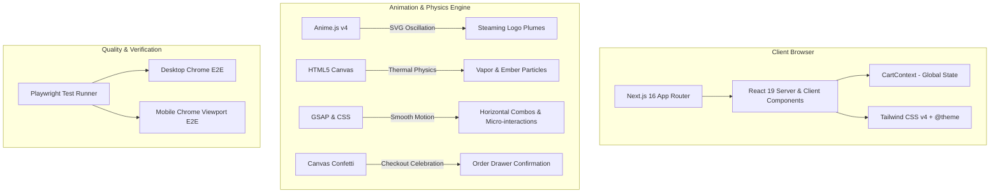

<div align="center">

# ☕ NS COFFEE — SPECIALTY ROASTERY & CAFE

**An agency-grade, sensory-driven specialty coffee landing page & interactive tasting experience.**

[](https://nextjs.org/)
[](https://react.dev/)
[](https://www.typescriptlang.org/)
[](https://tailwindcss.com/)
[](https://greensock.com/)
[](https://playwright.dev/)
[](LICENSE)

<br />

[Explore Features](#-key-features) • [Design System](#-design-system--tokens) • [Tech Stack](#-tech-stack--architecture) • [Getting Started](#-getting-started) • [Project Structure](#-project-structure) • [Testing](#-testing--quality-assurance)

<br />

```
   ( (      
    ) )      NS COFFEE ROASTERS · PORTLAND, OR
  ........   ━━━━━━━━━━━━━━━━━━━━━━━━━━━━━━━━━━━━━━━━
  |      |]  "Crafted for the obsessed. Sourced from 2,100m
  \      /   volcanic soils. Roasted with convection precision."
   `----'    
```

</div>

---

## 📖 Overview

**NS Coffee** is an editorial-grade, ultra-responsive digital flagship designed for a boutique micro-roastery and specialty tasting room based in the Pearl Arts District of Portland, Oregon.

Representing a top-tier digital web experience, the application pairs an obsidian aesthetic with kinetic typography, physics-based SVG and Canvas animations, interactive sensory profiling, and a reactive ordering workflow.

Every component is architected from scratch to evoke the tactile warmth, scientific precision, and artisanal craftsmanship of third-wave specialty coffee culture.

---

## ✨ Key Features

### 1. 🎨 Animated Brand Identity & Steam Physics
- **Handcrafted Ceramic Cup Vector**: Custom SVG mark featuring a ceramic cup, saucer, and embossed `NS` monogram.
- **Physics-Driven Steam Streams**: Multi-frequency SVG path oscillation powered by **Anime.js** creating natural convection plumes.
- **HTML5 Canvas Particle Engine**: Custom real-time particle simulation rendering floating thermal vapor droplets and ambient glowing ember sparks around the floating hero cup.

### 2. ⚡ Kinetic Hero Section
- **Editorial Typography**: Bold, condensed headlines in `Big Shoulders Display` with staggered entrance animations.
- **Micro-Telemetry Badges**: Displays elevation (`2,150 MASL`), extraction protocol (`16h Kyoto Cold Drip`), and conditioning status (`48-Hour Fresh Degas`).
- **Layered 3D Floating Coffee Visual**: Floating porcelain brew composition featuring dynamic coffee splash bursts and interactive one-click quick add.

### 3. 🎯 Curated "Best in NS Cafe" Menu
- **6 Specialty Micro-Lots & Signatures**:
  - *Ethiopian Yirgacheffe G1* (Washed Heirloom, 2,150 MASL)
  - *Kyoto 16-Hour Cold Drip* (Dutch Slow Tower, Colombian Huila)
  - *Spanish Smoked Cortado* (9-Bar Ristretto + Hickory Char)
  - *Velvet Pistachio Cappuccino* (Bronte Pistachio Emulsion)
  - *Cascara Botanical Nitro Tonic* (Sun-Dried Coffee Cherry)
  - *Midnight Sumatra Mandheling* (Wet-Hulled Volcanic Dark)
- **Live Search & Filter**: Instant filtering across categories (*Single Origin*, *Slow Cold Drip*, *Espresso Craft*, *Signature Lattes*) and real-time keyword search.
- **Sensory Radar Bars**: Micro-meters displaying 1–5 ratings for **Acidity**, **Body**, **Sweetness**, and **Aroma**.

### 4. 🔄 Interactive Combos (Horizontal Carousel & Stepper)
- **Signature Curated Combos**:
  - `01` **The Morning Ritual**: Artisanal Flat White + Normandy Butter Brioche Croissant *(Save 22%)*
  - `02` **The Roaster's Tasting Flight**: 3-Continent Pour-Over Triad + Cupping Spoon *(Save 24%)*
  - `03` **The Barista Reserve & Home Tin**: 2x Nitro Cascara on Tap + 250g Nitrogen-Flushed Tin *(Save 26%)*
- **Rich Interaction**: Autoplay ticker with smooth progress bar, touch swipe for mobile, keyboard-accessible pause/play, and manual step navigation.

### 5. 🧭 Sensory Roast Finder (Interactive Matcher)
- **Algorithmic Matcher**: 3-step recommendation matrix matching flavor preferences (floral, cacao, smoky, sweet), brewing methods (pourover, cold drip, espresso, latte), and drinking ritual times.
- **Real-Time Profile Resolution**: Instantly displays the cupping score, origin elevation, sensory traits, and a one-click CTA to add the recommendation directly to the order tray.

### 6. 🔬 4-Pillar Roastery Craft Journey
- **Volcanic Micro-Lots**: Direct ethical trade with smallholders paying 240% above fair-trade floor prices.
- **Convection Drum Roasting**: Smooth thermodynamic heat transfer using the closed-loop Loring S35 Kestrel system.
- **Nitrogen Peak Conditioning**: 48-hour controlled degassing in oxygen-purged silos.
- **Scientific Extraction**: Slayer 9-bar needle-valve espresso and 1 drop/second Kyoto glass towers.

### 7. 🛍️ Reactive Slide-over Order Drawer
- **Global Context State (`CartContext`)**: Dynamic item additions, removals, and quantity incrementing.
- **Live Calculation**: Instant computation of subtotal, combo bundle savings, and tray badge counter.
- **Celebratory Confetti Checkout**: Powered by `canvas-confetti` upon order dispatch with full accessible dialog controls (`Escape` key support, click-outside dismissal).

### 8. 📍 Tasting Room Counter & VIP Drop Club
- **Physical Roastery Details**: Address (`428 NW 11th Ave, Pearl Arts District, Portland, OR`), counter hours, and public weekend cupping schedule.
- **Micro-Lot Drop Club**: Email subscription component for limited seasonal allocations.

---

## 🎨 Design System & Tokens

Crafted in alignment with the tokens defined in [`Design/DESIGN.md`](file:///d:/Freeleansing/Potfolio%20Projecta/Coffee-Cafe/Design/DESIGN.md):

| Token Role | Value / Hex | Usage | Contrast Ratio |
|---|---|---|---|
| **Primary Ember** | `#ff5b14` | Brand accents, CTAs, flame steam, highlights | 6.37:1 (AA on dark) |
| **Obsidian Black** | `#0b0a09` | Deep matte canvas & background | 16.25:1 (AAA) |
| **Steamed Cream** | `#efe8dc` | Primary typography, ceramic steam plume | 16.25:1 (AAA on black) |
| **Surface Panel** | `#161412` | Elevated cards, search inputs, containers | Elevated contrast |
| **Ash / Muted** | `#8c847a` | Secondary descriptions, telemetry, metadata | Accessible body |
| **Border Accent** | `#24201c` | Hairline dividers, subtle card borders | Subtle structure |

### 🔤 Typography Hierarchy
- **Display**: [`Big Shoulders Display`](https://fonts.google.com/specimen/Big+Shoulders+Display) — High-impact, condensed, uppercase typography.
- **Telemetry & Technical**: [`JetBrains Mono`](https://fonts.google.com/specimen/JetBrains+Mono) — MASL elevation, roast temperatures, pricing, and cupping scores.
- **Body & Interface**: [`Plus Jakarta Sans`](https://fonts.google.com/specimen/Plus+Jakarta+Sans) — Legible, geometric body copy and descriptions.

---

## 🛠 Tech Stack & Architecture



### Stack Breakdown

| Layer | Technology | Version | Purpose |
|---|---|---|---|
| **Framework** | [Next.js](https://nextjs.org/) | `^16.4.6` | App Router, Turbopack, SEO metadata & SSR |
| **UI Library** | [React](https://react.dev/) | `^19.3.1` | Concurrent rendering & modern hooks |
| **Language** | [TypeScript](https://www.typescriptlang.org/) | `^7.0.2` | Strict end-to-end type safety |
| **Styling** | [Tailwind CSS](https://tailwindcss.com/) | `^4.3.5` | Modern CSS variables with `@theme` engine |
| **Motion Physics** | [Anime.js](https://animejs.com/) | `^4.5.0` | SVG morphing & staggered kinetic typography |
| **Kinetic Motion** | [GSAP](https://greensock.com/) | `^3.15.1` | Smooth horizontal scroll mechanics |
| **Particles** | HTML5 Canvas API | Native | Lightweight ambient vapor and ember generation |
| **Celebrations** | [Canvas Confetti](https://www.npmjs.com/package/canvas-confetti) | `^1.9.4` | Particle explosion on order dispatch |
| **Icons** | [Lucide React](https://lucide.dev/) | `^1.78.0` | Accessible, minimalist SVG iconography |
| **Testing** | [Playwright](https://playwright.dev/) | `^1.65.1` | Cross-browser desktop & mobile E2E test suites |

---

## 📁 Project Structure

```bash
Coffee-Cafe/
├── Design/                         # Brand design specifications & tokens
│   ├── DESIGN.md                   # Complete design system token document
│   ├── design-tokens.json          # Machine-readable token definitions
│   ├── tailwind-v4.css             # Theme variable mappings
│   └── variables.css               # OKLCH color definitions
├── public/                         # Optimized static media assets
│   ├── hero-coffee-cup.webp        # Floating porcelain cup with NS emblem
│   ├── hero-coffee-splash.webp     # Liquid splash dynamic burst layer
│   └── ...                         # Visual loop assets
├── src/
│   ├── app/
│   │   ├── globals.css             # Tailwind v4 @theme, custom utilities & fonts
│   │   ├── layout.tsx              # Root HTML wrapper, metadata & theme provider
│   │   └── page.tsx                # Single-page layout assembling all sections
│   ├── components/
│   │   ├── brand/
│   │   │   ├── Logo.tsx            # Animated vector ceramic cup & steam plume
│   │   │   └── SteamCanvas.tsx     # Canvas particle engine for rising vapor & embers
│   │   ├── combos/
│   │   │   └── HorizontalCombos.tsx# Interactive combos carousel with touch swipe & autoplay
│   │   ├── experience/
│   │   │   ├── RoastFinder.tsx     # 3-step interactive sensory recommendation engine
│   │   │   └── RoasteryProcess.tsx # 4-pillar craft and roasting showcase
│   │   ├── footer/
│   │   │   └── Footer.tsx          # Roastery address, tasting hours & VIP newsletter
│   │   ├── hero/
│   │   │   ├── CoffeeHeroVisual.tsx# Layered visual with backlight, splash & cup
│   │   │   └── HeroSection.tsx     # Staggered typography, micro-labels & CTAs
│   │   ├── navigation/
│   │   │   ├── CartDrawer.tsx      # Slide-over order tray with confetti checkout
│   │   │   └── Navbar.tsx          # Glassmorphic header with cart badge
│   │   └── showcase/
│   │       ├── CoffeeCard.tsx      # Product card with SCA notes & quick-add
│   │       ├── CoffeeMenu.tsx      # Curated menu with live search & category filters
│   │       └── TastingRadar.tsx    # 4-metric sensory profile meter (scale 1-5)
│   ├── context/
│   │   └── CartContext.tsx         # Global state for items, pricing & modal visibility
│   ├── data/
│   │   ├── coffees.ts              # Specialty catalog with sensory ratings & origin specs
│   │   └── combos.ts               # Signature pairing packages & discount data
│   └── lib/
│       └── utils.ts                # Styling utilities (clsx & tailwind-merge)
├── tests/
│   └── e2e/
│       └── landing.spec.ts         # Playwright E2E test suite
├── next.config.mjs                 # Next.js build configuration
├── playwright.config.ts            # Playwright multi-device test runner configuration
├── package.json                    # Dependencies & npm build scripts
├── postcss.config.mjs              # PostCSS plugins
└── tsconfig.json                   # TypeScript compiler configuration
```

---

## 🚀 Getting Started

### Prerequisites

Ensure you have the following installed on your workstation:
- **Node.js**: `18.18.0` or later (Node `20.x` LTS recommended)
- **npm**: `9.x` or later (or `pnpm` / `yarn`)

### 1. Clone the Repository

```bash
git clone https://github.com/nouman030/Coffee-Cafe.git
cd Coffee-Cafe
```

### 2. Install Dependencies

```bash
npm install
```

### 3. Launch Development Server

```bash
npm run dev
```

Open [http://localhost:3000](http://localhost:3000) in your browser to view the application with Hot Module Replacement (Turbopack).

### 4. Create Production Build

```bash
npm run build
npm run start
```

---

## 🧪 Testing & Quality Assurance

This project includes end-to-end test coverage powered by **Playwright**, testing both desktop and mobile viewports.

### Run Automated E2E Tests

```bash
npm run test:e2e
```

### Run Tests with Interactive UI

```bash
npx playwright test --ui
```

### Test Coverage Highlights

- [x] **Brand Logo**: Verifies SVG cup, steam elements, and brand typography rendering.
- [x] **Hero Section**: Tests kinetic headline presence, MASL telemetry, and floating visual.
- [x] **Showcase Filtering**: Validates real-time category switching and search query filtering.
- [x] **Cart & Checkout**: Tests drawer slide-out, item additions, quantity management, and celebratory order dispatch.
- [x] **Interactive Combos**: Confirms carousel step controls, autoplay interval, and swipe support.
- [x] **Sensory Roast Finder**: Validates dynamic algorithm outputs based on user flavor selection.
- [x] **Responsive Layout**: Validates zero horizontal overflow on mobile viewports (375px+).

---

## 📜 Available NPM Scripts

| Command | Action |
|---|---|
| `npm run dev` | Starts local Next.js development server with hot-reload |
| `npm run build` | Compiles production-ready optimized build with TypeScript type-checking |
| `npm run start` | Serves the compiled production build locally |
| `npm run test:e2e` | Runs cross-browser Playwright end-to-end test suite |

---

## ♿ Accessibility & Performance

- **Semantic HTML5**: Native `<header>`, `<main>`, `<section>`, `<nav>`, and `<footer>` landmarks.
- **Accessible Dialogs**: `role="dialog"`, `aria-modal="true"`, and keyboard `Escape` dismissals on the slide-over cart.
- **Contrast Ratios**: Verified 16.25:1 AAA contrast on primary text surfaces and 6.37:1 AA on primary call-to-actions.
- **Image Optimization**: Modern `.webp` format assets with fallback sources and zero layout shift.
- **Mobile First**: Fluid clamp typography and touch-swipe event listeners for mobile devices.

---

## 🗺️ Roadmap & Future Enhancements

- [ ] **Stripe / Square Integration**: Live payment gateway checkout for bean shipments.
- [ ] **Roast Telemetry Dashboard**: Live IoT connection showing real-time convection drum roast curves.
- [ ] **Subscription Roaster Club**: Recurring bi-weekly or monthly automated bean deliveries.
- [ ] **Multi-language Localization**: Japanese and Spanish tasting notes for international connoisseurs.

---

## 📄 License

This project is open-source and licensed under the [MIT License](LICENSE).

---

## 👤 Author

**Nouman Patel**
- GitHub: [@nouman030](https://github.com/nouman030)
- Repository: [github.com/nouman030/Coffee-Cafe](https://github.com/nouman030/Coffee-Cafe)

<div align="center">
  <sub>Crafted with passion, convection heat, and specialty single-origin coffee.</sub>
</div>
